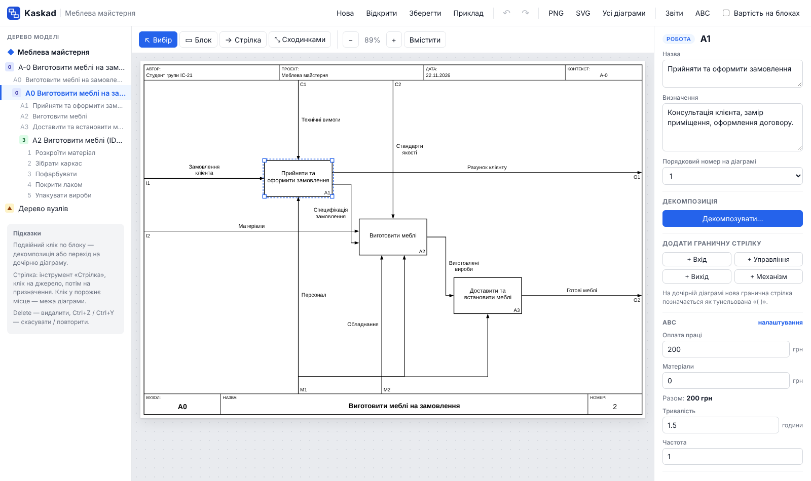

# Kaskad

**Kaskad** — навчальний CASE-засіб для моделювання бізнес-процесів (аналог BPwin / AllFusion Process Modeler) для виконання практичних робіт.
Працює повністю в браузері: без сервера, без реєстрації, дані зберігаються у файлі `.json` та в чернетці браузера.

🌐 **Онлайн:** https://yryzhyk.github.io/kaskad/



## Можливості

| Розділ | Що вміє |
|---|---|
| **IDEF0** | Властивості моделі (назва, автор, мета, точка зору); контекстна діаграма A-0; декомпозиція будь-якого блоку (3–6 блоків, з попередженням); розташування «сходинками»; нумерація A-0, A0, A1, A11…; стрілки входу, управління, виходу, механізму з підписами; ортогональна прокладка; граничні стрілки з кодами ICOM (I1, C1, O1, M1); розгалуження і злиття; поле «Визначення»; рамка BPwin (ВУЗОЛ / НАЗВА / НОМЕР) |
| **Дерево вузлів** | Будується автоматично з ієрархії IDEF0 |
| **IDEF3** | Декомпозиція блоку IDEF0 (або UOB) у діаграму IDEF3; UOB з номерами; перехрестя & / X / O (синхронні й асинхронні); зв'язки передування, відношення і потоку об'єктів; об'єкти-посилання |
| **ABC** | Одиниці грошей і часу; центри витрат; вартість, тривалість і частота для елементарних робіт (IDEF0 та IDEF3); автоматичний підрахунок для декомпозованих робіт; вартість на блоці; звіт ABC |
| **Звіти** | По моделі, по роботах, по стрілках, ABC — для всієї моделі або для обраної роботи з декомпозицією; копіювання таблиці у Word; експорт CSV |
| **Файли** | Збереження/відкриття `.json`; автозбереження чернетки; експорт PNG (3360×2376, біле тло, ≈300 dpi для A4) та SVG; експорт усіх діаграм у ZIP |

## Як користуватися

### Інтерфейс
* **Ліворуч** — дерево моделі: діаграми та роботи. Клік відкриває діаграму / вибирає роботу.
* **Посередині** — полотно з панеллю інструментів.
* **Праворуч** — властивості вибраного елемента. Якщо нічого не вибрано — властивості діаграми та моделі (назва, автор, мета, точка зору).

### Крок за кроком (IDEF0)
1. Заповніть властивості моделі на правій панелі.
2. Виберіть блок на діаграмі **A-0** і введіть його назву та визначення.
3. Додайте стрілки:
   * кнопками **«+ Вхід / + Управління / + Вихід / + Механізм»** на панелі властивостей блоку, або
   * інструментом **«Стрілка»**: клік на джерело, потім на призначення (або перетягування).
     * Клік у порожнє місце біля краю діаграми — це межа (зовнішнє середовище).
     * Клік на блоці як призначенні: верхня частина — **управління**, нижня — **механізм**, середина — **вхід**. Стрілка завжди виходить з правої сторони блоку (**вихід**).
     * Клік на існуючій стрілці як джерелі — **розгалуження**, як призначенні — **злиття**.
4. Виберіть блок і натисніть **«Декомпозувати…»** (або двічі клацніть по блоку). Оберіть IDEF0 чи IDEF3 і кількість блоків.
5. На дочірній діаграмі стрілки батьківського блоку з'являються біля країв з кодами ICOM. Під'єднайте їх: інструмент «Стрілка» → клік на граничну стрілку → клік на блок (для виходів — навпаки: блок → гранична стрілка).
6. Назви блоків і стрілок, визначення — на правій панелі. Підпис стрілки можна перетягнути мишею; сині квадрати на вибраній стрілці переміщують її відрізки; білі кружечки на кінцях — перепідключають стрілку.

### IDEF3
Інструменти: **UOB**, **Зв'язок**, **Посилання** (об'єкт-посилання), перехрестя **&**, **&║** (синхронне І), **X**, **O**, **O║** (синхронне АБО).
Тип перехрестя та синхронність можна змінити у властивостях; тип зв'язку (передування / відношення / потік об'єктів) — у властивостях зв'язку.

### ABC (функціонально-вартісний аналіз)
1. Кнопка **ABC** у верхньому меню: одиниці (за замовчуванням «грн» і «години») та центри витрат.
2. Для кожної роботи **без декомпозиції** задайте на правій панелі вартість по кожному центру витрат, тривалість і частоту (дробова частота, наприклад `0,3`, підходить для гілок після перехрестя X).
3. Для **декомпозованої** роботи вартість і тривалість обчислюються автоматично: сума *(значення дочірньої роботи × частота дочірньої)* — і для IDEF0, і для IDEF3.
4. Прапорець **«Вартість на блоках»** показує вартість у лівому нижньому куті блоків.

### Звіти
Кнопка **Звіти** → вкладки «Модель», «Роботи», «Стрілки», «ABC». Поле **«Обсяг»** — вся модель або обрана робота з усією її декомпозицією.
**«Копіювати для Word»** копіює таблицю з форматуванням (вставляйте у Word через Ctrl+V), **«Експорт CSV»** — файл для Excel (роздільник «;», UTF-8).

### Збереження і рисунки для звіту
* **Зберегти** — файл моделі `.json`; **Відкрити** — завантажити його назад. Чернетка також автоматично зберігається в браузері.
* **PNG** — поточна діаграма у високій роздільності на білому тлі; **SVG** — векторний варіант; **Усі діаграми** — ZIP з PNG усіх діаграм (включно з деревом вузлів).
* **Приклад** — відкриває навчальну модель «Меблева майстерня».

### Гарячі клавіші
`Ctrl+Z` — скасувати, `Ctrl+Y` (або `Ctrl+Shift+Z`) — повторити, `Delete` — видалити вибране, `Esc` — інструмент «Вибір», `Ctrl+S` — зберегти файл.

## Запуск локально

Потрібен [Node.js](https://nodejs.org/) 20 або новіший.

```bash
npm install
```

```bash
npm run dev
```

Відкрийте адресу, яку покаже Vite (зазвичай http://localhost:5173/kaskad/).

Збірка статичного сайту в теку `dist/`:

```bash
npm run build
```

## Тести

Автотести на Playwright (створення моделі, декомпозиція, стрілки, граничні стрілки, розгалуження/злиття, IDEF3 з перехрестями, підрахунок ABC, звіти, експорт PNG з кирилицею, збереження/відкриття, скріншоти з перевіркою накладань):

```bash
npx playwright install chromium
```

```bash
npm test
```

Скріншоти основних екранів зберігаються в [`docs/screenshots`](docs/screenshots).

## Публікація

Workflow [`.github/workflows/deploy.yml`](.github/workflows/deploy.yml) збирає сайт і публікує його на GitHub Pages при кожному пуші в `main` (у налаштуваннях репозиторію: Pages → Source: GitHub Actions). Тести запускає [`.github/workflows/tests.yml`](.github/workflows/tests.yml).

## Технології

Vite + TypeScript + React; діаграми малюються в SVG. Для діаграм вбудовано шрифт Arimo (метрично сумісний з Arial, з кирилицею), тому кирилиця однаково відображається на екрані та в експортованих PNG.
